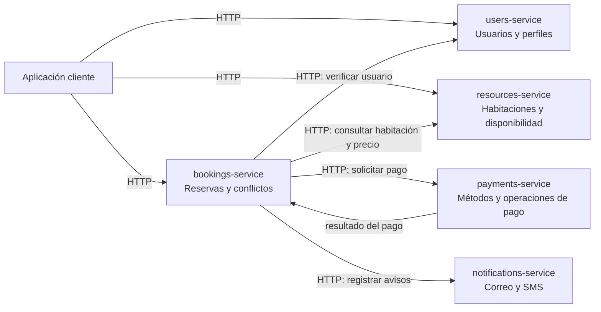

# Arquitectura del sistema de reservas

## Diagrama



**Cómo leerlo:** las flechas muestran llamadas HTTP entre servicios. En esta práctica los cinco se ejecutan por separado, y algunos llaman a otros durante una reserva. Pagos y avisos son simulados; más adelante los avisos podrían procesarse mediante eventos asíncronos.

## Decisiones y límites

| Servicio | Es dueño de | No debe hacer |
|---|---|---|
| `users-service` | Identidad, perfil, correo, teléfono y contraseña protegida. | Guardar reservas o pagos. |
| `resources-service` | Habitaciones reservables, hotel, descripción, capacidad, precio por noche y si están activas. | Crear reservas en nombre del servicio de reservas. |
| `bookings-service` | Solicitudes de reserva, habitación, fechas de ingreso/salida, forma de pago elegida, valor acordado, estado y hora de creación; verifica que no se crucen para el mismo recurso. | Ser dueño de los perfiles, habitaciones o transacciones de pago. |
| `payments-service` | Métodos aceptados, intentos, confirmaciones, fallos y demás operaciones de pago. | Cambiar directamente las fechas o los datos de una habitación. |
| `notifications-service` | Envío y registro de avisos por correo y SMS. | Decidir si una reserva o un pago son válidos. |

Cada servicio es responsable de sus propios datos. Los otros servicios guardan identificadores, como `user_id` o `room_id`, en vez de compartir las tablas o clases internas de ese servicio. En esta primera versión los identificadores están representados como UUID.

## Comunicación prevista

- El cliente usa HTTP/REST para solicitar operaciones y recibir una respuesta inmediata.
- `bookings-service` consulta a `users-service` para comprobar que la persona está registrada, y puede consultar a `resources-service` para confirmar que la habitación existe y se puede reservar.
- La reserva empieza en estado `PENDING`. En esta demo, Pagos registra un resultado exitoso simulado y Reservas cambia el estado a `CONFIRMED`.
- Tras el pago exitoso, Reservas pide a Notificaciones registrar un correo y un SMS. El contenido incluye el estado y la fecha de llegada (check-in).
- En esta demo las llamadas entre servicios son HTTP para que el flujo sea sencillo de observar. Más adelante, notificaciones podría reaccionar a eventos asíncronos.
- `bookings-service` obtiene correo y teléfono desde el perfil en `users-service` y los entrega a `notifications-service` para crear los dos avisos.
- El servicio de pagos evita duplicar cobros simulados para una misma reserva. En una integración real se necesitarían además garantías de idempotencia del proveedor.

Los cinco servicios están implementados como demos locales. Los datos viven en memoria; los pagos y las notificaciones no salen a proveedores externos.

## Clean Architecture dentro de cada servicio

Cada servicio mantiene sus propias capas:

```text
app/
├── domain/          # conceptos y reglas propias del negocio
├── application/     # acciones o casos de uso
├── infrastructure/  # forma concreta de guardar datos o llamar a otros sistemas
└── presentation/    # endpoints HTTP y formatos de entrada/salida
```

La petición entra por `presentation`, llega al caso de uso en `application` y aplica las reglas del `domain`. La capa `infrastructure` cumple el contrato de repositorio que usa el caso de uso. El dominio no importa FastAPI ni conoce la lista en memoria.

## Regla clave: no aceptar fechas cruzadas

Para una misma `room_id`, dos reservas se cruzan si:

```text
nueva_llegada < reserva_existente_salida
y
nueva_salida > reserva_existente_llegada
```

Las fechas de salida son exclusivas: una reserva del 8 al 11 y otra del 11 al 14 no se cruzan. La regla está en `bookings-service`, porque ese servicio es dueño de las reservas.

### Límite de esta primera versión

La comprobación vive en memoria y no evita por sí sola que dos solicitudes simultáneas, en servidores distintos, confirmen el mismo recurso. Antes de producción, la regla debe protegerse también con persistencia y control de concurrencia en una base de datos. Es una mejora futura de fiabilidad, no algo que resuelva la lista en memoria.
