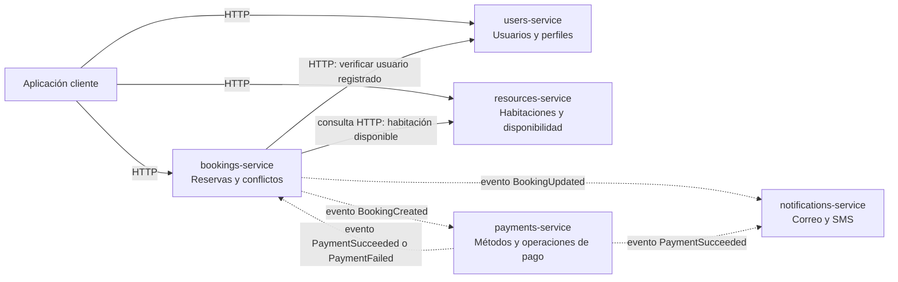

# Arquitectura del sistema de reservas

## Diagrama



**Cómo leerlo:** las flechas continuas representan una petición que espera respuesta. Las punteadas representan un aviso que puede procesarse después. El diagrama muestra el diseño objetivo; en esta entrega solo están implementados `users-service` y `bookings-service`, y sus datos viven en memoria.

## Decisiones y límites

| Servicio | Es dueño de | No debe hacer |
|---|---|---|
| `users-service` | Identidad, perfil, correo, teléfono y contraseña protegida. | Guardar reservas o pagos. |
| `resources-service` | Habitaciones reservables, hotel, descripción, capacidad, precio y disponibilidad general. | Crear reservas en nombre del servicio de reservas. |
| `bookings-service` | Solicitudes de reserva, habitación, fechas de ingreso/salida, forma de pago elegida, valor acordado, estado y hora de creación; verifica que no se crucen para el mismo recurso. | Ser dueño de los perfiles, habitaciones o transacciones de pago. |
| `payments-service` | Métodos aceptados, intentos, confirmaciones, fallos y demás operaciones de pago. | Cambiar directamente las fechas o los datos de una habitación. |
| `notifications-service` | Envío y registro de avisos por correo y SMS. | Decidir si una reserva o un pago son válidos. |

Cada servicio es responsable de sus propios datos. Los otros servicios guardan identificadores, como `user_id` o `room_id`, en vez de compartir las tablas o clases internas de ese servicio. En esta primera versión los identificadores están representados como UUID.

## Comunicación prevista

- El cliente usa HTTP/REST para solicitar operaciones y recibir una respuesta inmediata.
- `bookings-service` consulta a `users-service` para comprobar que la persona está registrada, y puede consultar a `resources-service` para confirmar que la habitación existe y se puede reservar.
- La reserva empieza en estado `PENDING`. `payments-service` informa si el pago tuvo éxito o falló; `bookings-service` actualiza el estado de la reserva.
- Los avisos se prestan a comunicación asíncrona: reservas o pagos publican un evento y notificaciones lo procesa después.
- Tras un pago exitoso, y ante cada actualización de la reserva, `notifications-service` envía un mensaje por correo y otro por SMS. El contenido incluye el estado y la fecha de llegada (check-in) de la reserva.
- `notifications-service` obtiene los datos de contacto del perfil por `user_id`; `users-service` sigue siendo dueño del correo y del teléfono.
- Un evento puede llegar más de una vez. Los consumidores de pagos y notificaciones deberán reconocer duplicados cuando se implemente mensajería real.

En el esqueleto actual, `bookings-service` sí verifica el usuario consultando a `users-service`. La persistencia está en memoria. La consulta de habitación, el procesamiento del pago y el envío de notificaciones están documentados, pero aún no implementados.

## Clean Architecture dentro de cada servicio

Cada servicio mantiene sus propias capas:

```text
app/
├── domain/          # conceptos y reglas propias del negocio
├── application/     # acciones o casos de uso
├── infrastructure/  # forma concreta de guardar datos o llamar a otros sistemas
└── presentation/    # endpoints HTTP y formatos de entrada/salida
```

La petición entra por `presentation`, llega al caso de uso en `application` y aplica las reglas del `domain`. La capa `infrastructure` cumple el contrato de repositorio que usa el caso de uso. El dominio no importa FastAPI ni conoce la lista en memoria.

## Regla clave: no aceptar fechas cruzadas

Para una misma `room_id`, dos reservas se cruzan si:

```text
nueva_llegada < reserva_existente_salida
y
nueva_salida > reserva_existente_llegada
```

Las fechas de salida son exclusivas: una reserva del 8 al 11 y otra del 11 al 14 no se cruzan. La regla está en `bookings-service`, porque ese servicio es dueño de las reservas.

### Límite de esta primera versión

La comprobación vive en memoria y no evita por sí sola que dos solicitudes simultáneas, en servidores distintos, confirmen el mismo recurso. Antes de producción, la regla debe protegerse también con persistencia y control de concurrencia en una base de datos. Es una mejora futura de fiabilidad, no algo que resuelva la lista en memoria.
